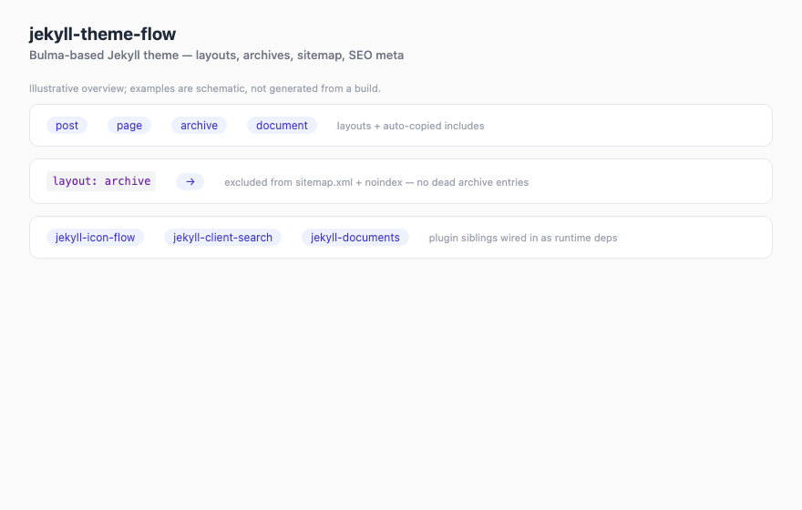

# jekyll-theme-flow

[](https://github.com/gundestrup/jekyll-theme-flow)
[](https://github.com/gundestrup/jekyll-theme-flow/actions/workflows/ci.yml)
[](https://rubygems.org/gems/jekyll-theme-flow)
[](https://codecov.io/gh/gundestrup/jekyll-theme-flow)
[](https://www.ruby-lang.org/)
[](https://jekyllrb.com/)
[](LICENSE.txt)
[](https://deepwiki.com/gundestrup/jekyll-theme-flow)
[](https://www.codefactor.io/repository/github/gundestrup/jekyll-theme-flow)
[](https://github.com/gundestrup/jekyll-theme-flow)
[](https://sonarcloud.io/dashboard?id=gundestrup_jekyll-theme-flow)

A Jekyll theme built on [Bulma](https://bulma.io) (CSS) and
[Alpine.js](https://alpinejs.dev) (interactivity), offering several
standard layout shells you can switch per site or per page.

No Node toolchain required — Bulma compiles through Jekyll's own Sass
pipeline, and Alpine is vendored into the theme.

<!-- markdownlint-disable MD033 -->
<picture>
  <source
    srcset="docs/assets/jekyll-theme-flow-demo.avif"
    type="image/avif">
  <source
    srcset="docs/assets/jekyll-theme-flow-demo.webp"
    type="image/webp">
  
</picture>
<!-- markdownlint-enable MD033 -->

## Installation

```ruby
# Gemfile
gem "jekyll-theme-flow"
```

```yaml
# _config.yml
theme: jekyll-theme-flow
```

`theme:` alone gives you layouts, includes, Sass and assets — Jekyll
also auto-requires the theme's runtime dependencies
(`jekyll-client-search`, `jekyll-icon-flow`, `jekyll-seo-tag`,
`jekyll-sitemap`), so the tags, search assets, SEO meta and
`sitemap.xml` work without listing them.

Every `flow.*`/`icon_flow.*`/`client_search.*` option has a sensible
default — the theme renders with zero config beyond `theme:`, and each
key can be overridden individually. When the theme is plugin-loaded it
also injects one config-level default that Liquid defaults can't reach:
`sass.quiet_deps: true`, which silences deprecation noise from the
vendored Bulma Sass while keeping warnings from *your* Sass visible
(set it explicitly to `false` to opt out).

To additionally enable the theme's own hooks (automatic sitemap/noindex
exclusion for archived pages and the `flow.sitemap` switch), load it as
a plugin too — either list it under `plugins:`:

```yaml
plugins:
  - jekyll-theme-flow
```

or move the gem into the `:jekyll_plugins` group in your Gemfile.

## Layouts

Set a site-wide default in `_config.yml`:

```yaml
flow:
  layout: sidebar-left   # sidebar-left | sidebar-right | topnav | bare
```

Or per page via front matter:

```yaml
layout: default
flow_layout: topnav      # overrides the site default for this page
```

Named layouts (`sidebar-left`, `sidebar-right`, `topnav`, `bare`) also
work directly in front matter.

| Shell | What you get |
| --- | --- |
| `sidebar-left` | Sticky left sidebar with expandable nav tree + content column (default) |
| `sidebar-right` | Same, sidebar on the right |
| `topnav` | Bulma navbar with hover dropdowns for children, no sidebar |
| `bare` | Content only — no nav chrome |

On mobile, sidebars collapse into a burger-toggled drawer (Alpine).

## Navigation model

The nav tree is driven by front matter — same convention as
just-the-docs:

```yaml
title: Child Page
parent: Section      # title of the parent page
nav_order: 3         # optional ordering
nav_exclude: true    # optional: hide from nav
```

`grand_parent:` is honoured for auto-opening the tree on grandchildren.
The current page's branch opens automatically; parents get a chevron
toggle. The current page and its direct parent are marked `is-active`
in both the sidebar tree and the topnav dropdown.

An optional `icon:` front matter key renders an icon next to the title —
in the flat branch *and* the dropdown branch (resolved by the configured
default `icon_flow.pack`):

```yaml
title: Home
icon: home
```

## Search (jekyll-client-search)

The theme integrates
[jekyll-client-search](https://github.com/gundestrup/jekyll-client-search)
(a runtime dependency — it's pulled in automatically). Enable it:

```yaml
client_search:
  enabled: true
  engine: minisearch        # or elasticlunr / semantic
  collections: [posts]      # and/or include_pages: true
  dropdown:
    enabled: true
    redirect_url: /search/
```

When enabled:

- **sidebar layouts** render a search bar in a top bar above the content
- **topnav** renders a smaller search field on the right of the navbar
- **bare** renders no search chrome
- the theme ships a **`search` layout** (`_layouts/search.html`) — add a
  page to your site to use it, since theme gems only ship
  `_layouts`/`_includes`/`_sass`/`assets`, not root pages:

  ```markdown
  ---
  layout: search
  title: Search
  permalink: /search/
  nav_exclude: true
  ---
  ```

All `client_search` options (fuzzy MiniSearch, Ollama embeddings, related
results, …) work as documented in the gem.

## Icons (jekyll-icon-flow)

Icons are provided by the
[jekyll-icon-flow](https://github.com/gundestrup/jekyll-icon-flow) gem
(a runtime dependency — pulled in automatically). Per-pack Liquid tags
emit normalized inline SVGs (`icon icon-<name>` classes, `currentColor`,
`1em` scaling):

```liquid
                     → default pack (icon_flow.pack)

              → brand icons
                → your site's own SVGs
```

Theme chrome uses `` for its search icon and navigation
chevrons, so switching the site's default pack to a brand/custom pack cannot
silently remove those controls. Set `icon_flow.enabled: false` to hide all
icons. `` remains a thin wrapper for site icons that
should follow `icon_flow.pack`.

```yaml
icon_flow:
  pack: lucide                     # lucide | simple | custom
  enabled: true                    # false = icon tags render nothing
  custom_dir: assets/icons/custom  # for icon_custom (e.g. svgrepo.com SVGs)
```

See the gem's README for the full styling contract and adapter model.

## Archiving pages

Superseded pages can stay live at their permalink under `/archive/`, get
a warning banner, and cross-link to their replacement — all driven by
one front matter key, `archive_link_current`.

**Archive a page** — set `layout: archive` and point it at the current
version:

```yaml
title: Section (2020)
layout: archive
permalink: /archive/section-2020.html   # convention: /archive/ + original path
archive_link_current: /section.html     # the page that replaced this one
nav_exclude: true
```

The `archive` layout renders a Bulma warning banner ("This is an
archived version" + link to the current page), then a "Versions of this
page" footer listing the current version and sibling archives. Archived
pages also get `<meta name="robots" content="noindex">` automatically —
`noindex: true` works standalone on any page (e.g. a search page).

**Cross-link from the current page** — add one line at the bottom of the
current version:

```liquid

```

It renders a "Previous versions" footer listing every page whose
`archive_link_current` points back. Archiving a future version then
needs zero link maintenance.

**Archive index** — ship your own page using the `archive-index` layout:

```yaml
---
layout: archive-index
title: Archive
permalink: /archive/
nav_exclude: true
---
```

It lists every `layout: archive` page sorted by `archive_link_current`.

**Sitemap exclusion** — when the theme is also loaded as a plugin
(`plugins:` list or the `:jekyll_plugins` Gemfile group — see
Installation), `jekyll-sitemap` is pulled in automatically and archived
pages are excluded from `sitemap.xml` by a built-in hook. No config or
front matter needed beyond `layout: archive`. Both switches:

```yaml
flow:
  sitemap: false                  # drop the sitemap generator entirely
  archive:
    sitemap_exclude: false        # keep archived pages in sitemap.xml
```

If the theme is consumed via `theme:` only (no plugin load), the hook
can't run — the equivalent convention is scoped front-matter defaults:

```yaml
defaults:
  - scope:
      path: "archive"
    values:
      layout: archive
      sitemap: false       # excluded from sitemap.xml
      nav_exclude: true
```

Files under `archive/` then need only `title`, `permalink` and
`archive_link_current`. (Without the defaults, set `sitemap: false` in
each page's front matter.)

**Strings** — all archive text is configurable:

```yaml
flow:
  archive:
    banner: "Dette er en arkiveret version."
    current_link: "Se den gældende version"
    versions_heading: "Versioner af denne side"
    previous_heading: "Tidligere versioner"
    current_label: "gældende"
    archived_label: "arkiveret"
    replaced_by: "erstattet af"
    index_empty: "Ingen arkiverede sider."
```

The demo site shows the convention: `archive/demo-2020.md` is archived
via the scoped defaults above, `demo-section.md` is its current version,
and `arkiv.md` uses `archive-index` at `/archive/`.

## Other config

```yaml
flow:
  layout: sidebar-left
  logo: /assets/logo.svg         # brand icon next to site.title (all pages)
  logo_enabled: true             # set false to hide without removing logo
  favicon: /assets/favicon.ico   # <link rel="icon">
  favicon_enabled: true          # set false to disable
  search_placeholder: "Search"   # placeholder text in the search field

  theme: auto                    # auto | light | dark — forces Bulma
                                 # data-theme; auto follows the OS
  breadcrumbs: true              # "Parent > Child" above content
  children_toc: true             # auto child list at page bottom
  back_to_top: false             # floating back-to-top button
  last_edit: true                # "Page last modified" in footer when
                                 # page.last_modified(_at/_date) is set
  last_edit_format: "%-d %B %Y"  # strftime for the timestamp
  table_wrap: true               # wrap tables in .table-container

  footer_text: "Powered by ..."  # optional footer line
  nav_cache: true                # precompute nav tree once per build
                                 # (plugin-loaded only); false = live
                                 # Liquid scans
  # archive:                     # banner/footer strings, see "Archiving pages"
```

## Just-the-docs conventions

The theme understands the front matter and config a
[just-the-docs](https://just-the-docs.com) site already carries, so
migrating mostly means swapping `theme:` and the Gemfile line:

| JTD convention | Behaviour here |
| --- | --- |
| `layout: home` / `page` / `post` | Aliases of `default` — pages keep working unchanged |
| `parent:`, `nav_order:`, `nav_exclude:`, `grand_parent:` | Same nav semantics; `nav_order` pages sort first, then unordered pages by title |
| `child_nav_order: reversed` (or `desc`) | Reverses the parent's child listing |
| `has_children: false`, `has_toc: false` | Disables the auto "Table of contents" child list |
| `nav_enabled: false` | Renders the `bare` shell for that page |
| `nav_external_links` | Appended to the sidebar nav (`title`, `url`, `opens_in_new_tab`, `hide_icon`) |
| `aux_links` + `aux_links_new_tab` | Header/topbar links (`{name: url}` hash) |
| `breadcrumbs: false` | Per-page opt-out of breadcrumbs (`flow.breadcrumbs: false` site-wide) |
| `favicon_ico:` | Used as the favicon when `flow.favicon` is unset (`flow.favicon_enabled` still applies) |
| `footer_content:` | Rendered as escaped plain text; use `footer_custom.html` for trusted markup |
| `last_edit_timestamp:` / `last_edit_time_format:` | Aliases for `flow.last_edit` / `flow.last_edit_format`; `last_modified_date` front matter also feeds the timestamp |
| `search_placeholder_custom` include | Overrides the search field placeholder (`flow.search_placeholder` is the config alternative) |
| `{: .note}` `.new` `.important` `.warning` `.highlight` | Callout classes mapped onto Bulma colours |
| `` | Emitted by `head.html` — `jekyll-seo-tag` is a runtime dependency, so meta tags work with zero config |

Site includes named `head_custom`, `header_custom`, `footer_custom`,
`nav_footer_custom`, `toc_heading_custom` or
`search_placeholder_custom` are honoured at the equivalent spots
(theme ships them empty — your file wins, same as JTD).
`header_custom` renders inside the top bar next to the search slot;
`nav_footer_custom` renders at the bottom of the sidebar. The
`footer_content` config value is escaped as text; put trusted HTML in
`footer_custom.html` instead.

## Nav performance

When the theme is plugin-loaded, a built-in generator groups and sorts
the nav pages once per build (`site.data["flow_nav"]`). This removes the
old full `site.html_pages` scan for every nav node on every rendered
page. Liquid still traverses the menu tree to emit each page's navigation,
so the final rendering cost remains proportional to the nav output.
Consumers using `theme:` without the plugin keep working: the includes
fall back to live scans. Disable the generator with
`flow.nav_cache: false`.

## Customization surface

Intentionally small — the theme relies on Bulma components and helpers
(`menu`, `navbar`, `columns`, `is-hidden-*`, spacing helpers) rather
than bespoke CSS. The only custom CSS is the app shell plus small
component styles (`_sass/flow.scss`): fixed/sticky sidebar, drawer
positioning, chevron rotation, brand icon sizing, callouts.

Override the usual Jekyll way: same-named files in your site win
(`_includes/`, `_layouts/`, `_sass/`). Bulma Sass variables can be
re-themed via `@use "bulma" with (...)`.

## Development

```bash
bundle install
bundle exec rake ci        # RuboCop, audit, Semgrep, real-site tests and gem contents
bundle exec jekyll serve   # demo pages in repo root
```

The theme's Ruby code in `lib/` is exercised through real consumer-site Jekyll
builds; SimpleCov measures that coverage and CI uploads it to Codecov. The
badge reflects `lib/` coverage — templates and vendored assets are not
instrumented. SonarCloud analyses the repository automatically;
the scanner excludes vendored Bulma and Alpine. Consumer-site tests assert
rendered HTML and accessibility attributes, while the Jekyll build compiles
Sass. The search dropdown JavaScript is owned by `jekyll-client-search` and
linted/tested in that gem; this theme does not currently run a dedicated HTML
validator or CSS linter.
Use `bundle exec rake "version:bump[patch]"` to bump the gemspec and lockfile,
add a dated changelog entry, and run `bundle exec rake version:pre_release`
before tagging. GitHub `release` environment and RubyGems trusted publishing
must be configured before publishing.

Known upstream noise: Bulma 1.0.x emits a handful of Sass `if()`
deprecation warnings during build — harmless, fixed upstream eventually.

## Inspiration

The nav model borrows the `parent`/`nav_order` convention from
[just-the-docs](https://just-the-docs.com), and the feature set was
extracted from real sites built on bulma-clean-theme-style overrides.

Planned: a `portfolio` one-pager layout (hero, about/services/media/
contact sections) inspired by
[jamigibbs/phantom](https://github.com/jamigibbs/phantom) — on our
Bulma + Alpine base.

## License

Copyright (C) 2026 Svend Gundestrup.
AGPL-3.0-or-later — see [LICENSE.txt](LICENSE.txt).
